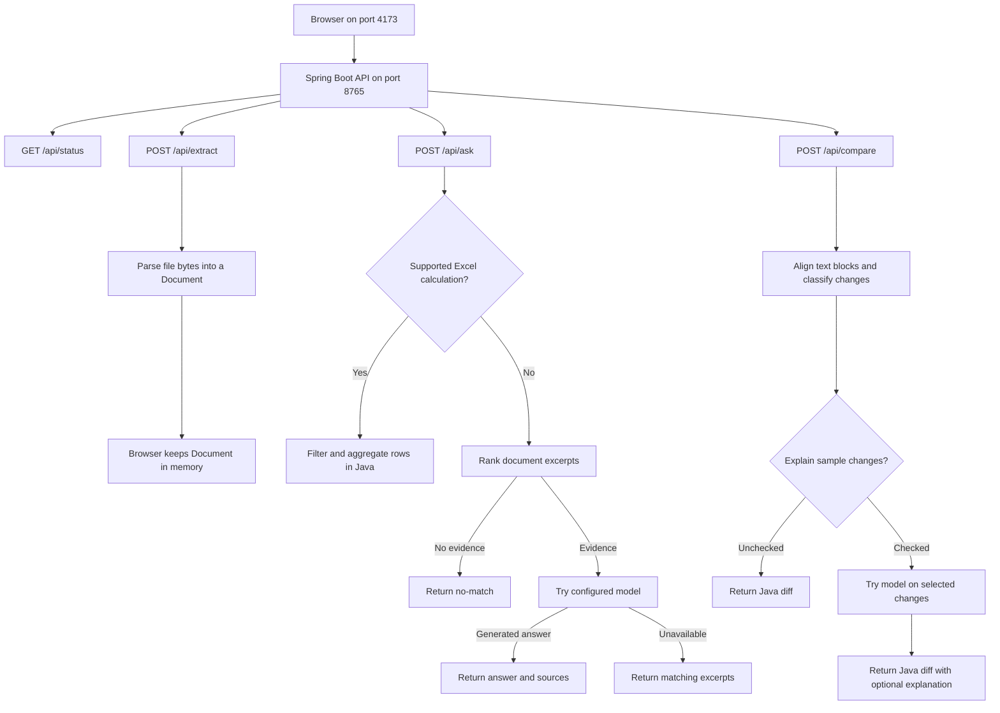

# Folio backend

Folio has four API routes. Java extracts files, calculates supported Excel aggregates, and compares versions. A model call is only needed to generate an answer from document excerpts or to explain a sample of version changes.

## Which path answered?

| What you see | Response signal | Where the result came from |
| --- | --- | --- |
| Spreadsheet calculation | `mode: "spreadsheet"` | Java evaluated the matching Excel rows or returned a calculation diagnostic. |
| Version comparison | `changes` with `explanation: null` | Java produced the change report. The explanation was unchecked, unavailable, or had no suitable changes. |
| AI explanation of sample changes | `explanation` with `text` and `sources` | The configured model explained excerpts from the Java-generated diff. |
| Groq AI answer | `mode: "groq-ai"` | Groq generated the answer from selected excerpts. |
| Local AI answer | `mode: "local-ai"` | The configured local model generated the answer. |
| Source excerpts | `mode: "excerpts"` | Java returned ranked passages. Generation was disabled, busy, or unsuccessful. |
| No matching passages | `mode: "no-match"` | Java found no matching excerpts and skipped generation. |

In the browser's Network tab, inspect the JSON response from `/api/ask` or `/api/compare`. The **Groq AI** badge at the top of the app reports the configured provider. The response to each request shows which path actually ran.

One local smoke run with the synthetic Atlas fixtures measured **66 ms** for a workbook total, **78 ms** for a version comparison without explanation, **172 ms** for a question with no matches, and **500 ms** for a Groq-backed question. These were single measurements of HTTP round trips from the same PC. They exclude the earlier file uploads and are not performance guarantees.

## Request map



The frontend's Node server supplies the application files and API address. The browser calls Java directly. Groq calls originate from the Java process.

## 1. Extract a file

`POST /api/extract?name=<url-encoded-filename>` takes a raw `application/octet-stream` body. The controller validates the filename and reads up to **5 MiB** per file. The browser uploads one file per request.

- PDFBox reads the text layer and labels sections by page. Image-only scans need OCR before upload.
- Apache POI reads Excel worksheets and Word body text. Excel contributes readable sheet sections for general Q&A and typed rows for calculations. A row carries its original one-based row number. Cell keys are zero-based column indexes. Each cell has display text and, if applicable, a numeric string. Formulas use saved values in the workbook.
- CSV, TSV, Markdown, source code, and other allowlisted text formats go through the text decoder. The structured calculation route handles XLS and XLSX.

The API returns a `Document` with `name`, `format`, `sections`, `truncated`, and `sheets`. Extraction is capped at **100,000 text characters** and **350 sections** per file. Excel extraction also caps the number of captured cells at **20,000** and reads through the first **120 columns**. The browser holds the extracted document in memory and sends it back on later requests. Java has no workspace database, background indexing job, or saved upload directory.

## 2. Ask a question

`POST /api/ask` takes JSON with `question` and `documents`. Each array item is the extracted `Document` from the upload step. The API accepts up to **eight documents**, a **1,200-character question**, and a **6 MiB request body**. Previous answers stay in the browser interface and are absent from this request.

### Excel calculation

The controller tries [SpreadsheetAnalysis](src/main/java/local/folio/SpreadsheetAnalysis.java) first. It recognizes sum, average, count, minimum, and maximum. The first populated row supplies headers. A request can name one grouping column, one sheet, and one equality filter. For example, `Sum Revenue by Region in Sales where Month = November` sums the matching workbook rows by region.

Java uses `BigDecimal` for numeric calculations. It reports how many rows contributed and includes examples with the original row numbers. A calculation can also return a diagnostic for an ambiguous column or sheet, a truncated workbook, or a nonnumeric metric cell. Check the answer and source cards together. Workbooks with subtotal rows or multiple tables on one sheet should be reduced to one data table per sheet before calculation.

### Document retrieval and generation

If the question doesn't match a spreadsheet command, [QuestionService](src/main/java/local/folio/QuestionService.java) splits the extracted text into passages and ranks them by keyword overlap. Rare terms count more, with a smaller bonus for filename and location matches. It retains up to eight distinct sources at or above 42% of the top score. Broad prompts like “Summarize the files” use opening excerpts and, when space remains, excerpts from near the end.

[LocalModel](src/main/java/local/folio/LocalModel.java) uses the current question and numbered excerpts to request a concise answer. When `GROQ_API_KEY` is configured, it calls GPT-OSS 20B with low reasoning effort and a 768-token completion budget. The browser receives the generated text plus the original selected excerpts. Use the source cards to check the answer. A source card shows what the model could see, and Folio does not verify generated claims against those excerpts.

The model client has one generation slot. If it's busy, the request returns matching excerpts immediately. Provider errors, timeouts, and unusable responses also produce excerpt fallback. The configured request timeout is 65 seconds.

## 3. Compare versions

`POST /api/compare` takes `before`, `after`, and the boolean `explain`. Both versions are extracted `Document` objects. The request has a **6 MiB JSON body** cap and accepts up to **400 passages per version**. It rejects truncated versions.

[VersionComparison](src/main/java/local/folio/VersionComparison.java) splits the text into blocks, pairs exact matches after whitespace normalization, and aligns remaining blocks by shared terms. It uses the longest sequence of matches that stayed in relative order to detect moves. The response includes the change type, earlier and revised excerpts with locations, and whether a paired passage changed position. The browser displays these side by side.

The dialog leaves `explain` unchecked by default. When checked, Java can ask the configured model to explain a sample of the changes and returns the sample as evidence alongside the explanation. The diff is always produced by Java, including when the explanation is unavailable. Heavily rewritten paragraphs may appear as a removal and an addition because alignment is based on shared text.

## Verify a request locally

From the repository root, build and start the API with Java 17 and Maven:

```powershell
mvn -f .\backend\pom.xml package
powershell -NoProfile -ExecutionPolicy Bypass -File .\backend\start.ps1
```

Use the status route to check the configured provider:

```powershell
Invoke-RestMethod 'http://127.0.0.1:8765/api/status'
```

For a reproducible comparison in the app, upload two small text files and use **Compare versions** with the explanation unchecked. For an Excel check, upload a workbook with the headers `Region` and `Revenue`, then ask `Sum Revenue by Region`. Check the result and its contributing row count against the workbook.

## Configuration and data boundaries

| Setting | Purpose |
| --- | --- |
| `FOLIO_BIND` and `PORT` | Java listen address and port. Defaults to `127.0.0.1:8765`. |
| `FOLIO_FRONTEND_ORIGINS` | Comma-separated browser origins allowed by the Java API. |
| `FOLIO_MODEL_NAME` and `FOLIO_MODEL_URL` | Optional local model and API base URL. The default local model port is 8766. |
| `GROQ_API_KEY` | Backend-only credential. On Windows the normal launcher can load it from the ignored `backend/.env` file. |

Run the launcher with `-LocalOnly` to disable Groq, or `-ExcerptsOnly` to disable model calls. When Groq generates a response, it receives the question, selected excerpts, and their file and location labels. The browser never receives the API key. Refreshing the page clears its workspace, and it cannot recall requests already sent to a model provider.

For request validation, see [WorkspaceController](src/main/java/local/folio/WorkspaceController.java). For extraction, see [DocumentReader](src/main/java/local/folio/DocumentReader.java) and the [Document record](src/main/java/local/folio/Document.java). The [root README](../README.md) covers the frontend and separate deployments.
